Появилась идея реализовать некую игру-головоломку с помощью искусственного интеллекта DeepSeek, GigaChat (ИИ). Идеи и намерения обсуждал с обоими ИИ, но реализация с DeepSeek – GigaChat, судя по опытам генерации и общению, плохо знает встроенный менеджер сцен Composer, возможно и сам Solar2D. После некоторого обсуждения с ИИ, остановился на Сокобан. **Сокобан** (яп. кладовщик) — это классическая компьютерная игра-головоломка японского происхождения. В ней игрок управляет кладовщиком, который должен перемещать ящики по лабиринту склада и ставить их на специально обозначенные целевые позиции.

В качестве игрового движка выбрал Solar2D, с ним немного был знаком, пробовал писать черновики — удобен для простых игр и быстрых прототипов. **Solar2D** — бесплатный кроссплатформенный фреймворк с открытым исходным кодом для создания 2D-игр и приложений, разработан компанией Corona Labs Inc. До 2020 года назывался Corona SDK. [https://solar2d.com/](https://solar2d.com/)

Некоторые возможности из описания:
*   **Одна кодовая база для разных платформ.** Тут следовало бы упомянуть iOS, Android, Amazon Fire, macOS, Windows, Linux, Apple TV, Fire TV, Android TV, HTML5, но работает на большинстве целевых платформ с возможными ограничениями — нет гарантии идентичного поведения везде (особенно, сложные нативные плагины). Я пробовал построить только Android (.apk, .aab — Android App Bundle формат для сборки apk маркетом при скачивании приложения — не в счет) приложение, понадобится установка Java Development Kit и Windows (сборка .exe) приложения;
*   **Язык программирования — Lua.** На нём реализуется логика приложений. Lua — лёгкий, быстрый и мощный язык сценариев, который используется в таких проектах, как Roblox, The Elder Scrolls Online, Don’t Starve, World of Warcraft, Angry Birds и других;
*   **Симулятор** для предварительного просмотра приложения на разных устройствах без компиляции и развёртывания. Симулятор позволяет сразу же после написания кода увидеть результат, достаточно сохранить результат;
*   **Расширение функциональности с помощью плагинов.** Они добавляют специфическую функциональность, например, интеграцию с рекламой, медиа, аналитикой;
*   **Открытый исходный код.** Фреймворк лицензирован по MIT, что даёт права на кастомизацию и распространение готовых приложений на своих условиях.

Но есть и ограничения, например:
*   Работает только с 2D-проектами;
*   Нет визуального редактора — только окно симулятора, консоль и код в IDE/редакторе;
*   Не подходит для крупных проектов;
*   Не поддерживает консоли.

**Структура проекта самой игры основана на Composer** — это официальная библиотека Solar2D для создания сцен (экранов) и управления ими. Она помогает структурировать проект: каждый экран обычно хранится в отдельном .lua-файле. Сцена — это изолированный экран приложения. Например: главное меню, экран игры, настройки. Composer отправляет сцене события. События обрабатывают через слушатели. Основные события:
*   **create** — сцена создаётся, но ещё не появилась на экране. Здесь строят визуальную часть сцены и добавляют объекты;
*   **show** — сцена появляется. Имеет две фазы. "will" — сцена ещё за экраном, но вот-вот появится. "did" — сцена полностью видима;
*   **hide** — сцена исчезает. Тоже имеет фазы "will" и "did";
*   **destroy** — сцена удаляется из памяти. Здесь производится очистка ресурсов, слушателей и таймеров.

Иконка приложения — сгенерирована с помощью GigaChat, JPEG картинка 1024х1024, изображение ящика с надписью Сокобан — была преобразована в набор под разные разрешения экрана (FHD, QHD...), как нужно в Solar2D с помощью сервиса [https://makeappicon.com/result/](https://makeappicon.com/result/), загрузить картинку, выбрать Android, получить архив, скопировать содержимое каталога android (drawable, каталоги под разные разрешения экрана mipmap%, playstore-icon.jpg) в каталог игры ...\Sokoban\AndroidResources\res.

Работа с проектом: изменение в файлах сразу же отображается в симуляторе или можно создать приложение Android, Windows, HTML5: File – Build – android… или windows… или HTML5... Указать Application name – имя приложения, Version name – версия.

### Основные моменты разработки игры

**1.**
Обсуждая намерения сделать игру (тетрис, сокобан, текстовый квест), запросил сформировать мне итоговый запрос на формирование основы игры: здесь я получил простой, но готовый каркас всей игры. Полученный результат был простым - уровень был просто комнатой без задачи. Но игра заработала. Обсуждать можно с...

Первый запрос-заготовка был таким:

> Я хочу получить игру Сокобан на Lua Solar2d, с использованием composer, коротко: заставка, игровое поле, переход между уровнями - просто загрузка новой карты(карта - задается текстовой картой). Проект организован так:
> project/
> ├── main.lua
> ├── scenes/
> │   ├── menu.lua
> │   ├── levelSelect.lua
> │   └── game.lua
> └── modules/
>     ├── data.lua
>     ├── gameState.lua
>     ├── undo.lua
>     └── save.lua
> 
> main.lua – точка входа, запускает сцену меню.
> scenes/menu.lua – главное меню (новая игра / загрузка / выход). scenes/game.lua – основная игровая сцена, управляет интерфейсом и логикой.
> modules/data.lua – хранит все статические данные: локации, предметы, диалоги, уровни и т. п.
> modules/gameState.lua – фабрика для создания объекта состояния игры (текущая локация, инвентарь, флаги, очки и пр.).
> modules/save.lua – загрузка/сохранение состояния в JSON.
> 
> Эта архитектура отделяет данные от логики и UI, что позволяет легко адаптировать её под любой жанр – текстовый квест, головоломку (сокобан), аркаду (тетрис) и т.д. Ваша задача создать новую игру на основе этой архитектуры.
> 
> Требования к игре (общие)
> Использовать Solar2D с composer. Минимум 3–4 уровня / локации / экрана. Наличие инвентаря или системы очков/ресурсов (отображается на экране). Сохранение состояния игры в JSON. Интерфейс: текстовое описание (для квестов) или графические элементы (для аркад) – на ваше усмотрение.
> 
> Что нужно изменить / дописать:
> 1. Модуль данных (modules/data.lua) Замените содержимое на свои данные. Для текстового квеста – оставьте структуру локаций, предметов, диалогов. Для сокобана – определите уровни как карты (массивы строк), координаты игрока, цели, стены, ящики. Для тетриса – определите набор фигур (матрицы 4x4), цвета, начальную позицию. Пример структуры для сокобана: lua data.levels = { { name = "Уровень 1", map = { "#####", "# .#", "# $#", "# @ #", "#####" }, player = { x = 3, y = 4 }, targets = { {x=3,y=2} }, boxes = { {x=3,y=3} } } }
> 2. Модуль состояния (modules/gameState.lua) Измените поля состояния под нужды игры. Например, для сокобана: lua function gameState.new() return { currentLevel = 1, playerPos = {x=0,y=0}, boxes = {}, moves = 0, flags = {}, -- для достижений inventory = {} -- если нужен инвентарь } end
> 3. Сохранение (modules/save.lua) Обычно не требует изменений, если вы сохраняете состояние в JSON. Проверьте, что все поля сериализуются.
> 4. Основная сцена (scenes/game.lua) Это ядро игры. Здесь нужно: Переписать функцию updateUI() – обновлять текст или графику в зависимости от текущего состояния. Переписать обработчики кнопок (onMove, onTalk, onTake, onUse) или заменить их на свои действия (например, onMoveUp, onMoveDown, onAction). Вместо descriptionText можно использовать display.newImageRect для отрисовки уровней или display.newText для информации. Адаптировать логику переходов, проверки победы. Для сокобана вы можете оставить кнопки «Вверх/Вниз/Влево/Вправо» и «Сброс».
> 5. Меню (scenes/menu.lua) Обычно не требует изменений, если оставить «Новая игра», «Загрузить», «Выйти». Механизм загрузки/сохранения (JSON).
> 
> Использование composer для переключения сцен. Общая схема: данные → состояние → UI → пользовательский ввод → изменение состояния → обновление UI. Сокобан data.lua – массив уровней (карта, цели, ящики). gameState.lua – текущий уровень, позиции. Кнопки: направления движения, «Сброс уровня». updateUI() – рисует сетку с символами или изображениями. Сохранение – номер уровня и позиции. gameState.lua – поле, уровень. updateUI() – отрисовывает игровое поле.
> 
> Так же, нужен экран выбора уровней (scenes/levelSelect.lua), на котором можно листать "уровни" влево вправо, выбирая, с тем, чтобы была выведена миниатюра — обеспечить визуальное превью уровня (миниатюра поля) до запуска. Реализовать циклическое листание уровней влево/вправо. Отображать статус прохождения уровня (пройдено или ничего не писать).
> 
> Нужен откат ходов, со всей историей игровой карты - от первого хода до конца, при прохождении уровня - удалить информацию. История отката - это временное состояние игровой сессии, с отдельным модулем(modules/undo.lua).
> 
> Инструкция по запуску Установите Solar2D. Создайте проект и скопируйте файлы в соответствующие папки. Запустите через симулятор или устройство. Чего мы ожидаем от ответа DeepSeek: Полный код всех файлов с вашей реализацией. Краткое описание, как игра работает. Инструкция по добавлению новых уровней/локаций

**2.**
Изначально игра была с кнопками управления.

<table>
  <tr>
    <td>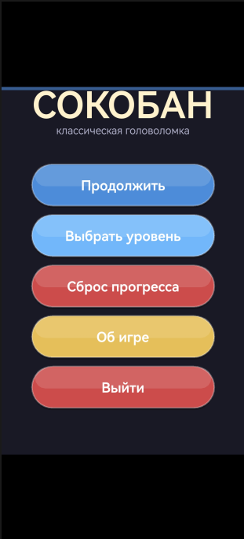</td>
    <td>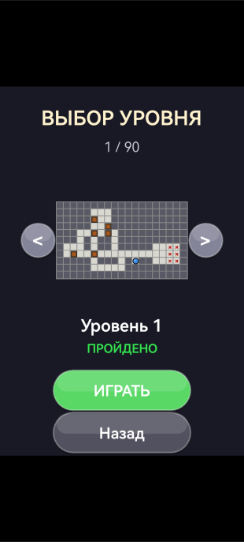</td>
    <td>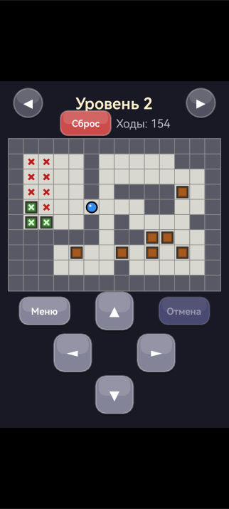</td>
  </tr>
</table>

При тестировании игры - когда шла отладка работы кнопок, сохранения прогресса, пройден уровень или нет - когда перепроходил одни и те же уровни, захотелось ускорить процесс сделать что-то из:
1) авторешатель уровня игры;
От авторешений отказался, обсудив идею с ИИ - поиск решения для ящиков 1-4 может дать результат, но большее их количество и сложные уровни могут стать проблемой долгого поиска решения.
2) управление тачами-касаниями, чтобы выбрать какой ящик - куда сдвинуть.
Это было решено реализовать для большего удобства игры, без ручного управления буквально каждым шагом, но оно не заменяет некоторых промежуточных сдвигов ящиков. Перемещение осуществляется с помощью алгоритма **BFS (Breadth-First Search)** - это поиск в ширину - **обход в ширину через очередь, который для невзвешенного графа/сетки даёт кратчайший путь.**

Его идея: идти от стартовой точки **волной по уровням**. Сначала проверяем всё, что на расстоянии 1 шаг, потом всё на расстоянии 2 шага, потом 3 и так далее.

**Принцип работы:**
1. Кладём стартовую клетку/состояние в **очередь** (queue).
2. Помечаем её как посещённую.
3. Пока очередь не пуста:
   - берём из очереди **первый** элемент (FIFO),
   - если это цель — готово,
   - иначе добавляем в конец очереди всех его непосещённых соседей.
4. Чтобы не ходить по кругу, используем таблицу `visited`.

На сетке соседи — это обычно 4 клетки: вверх, вниз, влево, вправо.

**Главное свойство:** если все шаги одинаковой «стоимости» (например, один ход = 1), BFS всегда находит **кратчайший путь**. Потому что он не углубляется далеко в одну сторону, а расширяется равномерно.

В `game.lua` BFS используется в `findDeliveryPath`, состояние — это не просто клетка, а пара:
- где стоит игрок,
- где стоит выбранный ящик.

Очередь хранится в таблице `queue`, обход идёт через `head`, посещённые состояния записываются в `visited` по ключу `stateKey`. Как только ящик оказывается на нужной клетке, BFS возвращает последовательность ходов `path`, и дальше запускается анимация.

В игре с управлением касаниями стало понятно, что нужна альбомная ориентация игры — нужно делать ящики большего размера для попадания пальцем по ним. Сделали поворот сцен на 90 градусов, нюанс.

<div align="center">
  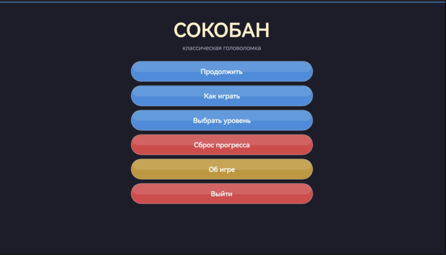
  <br><br>
  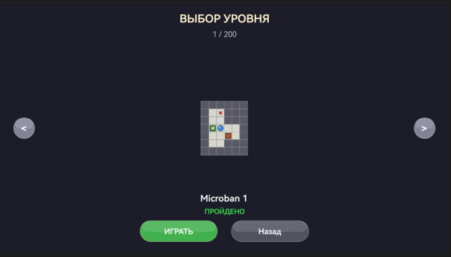
  <br><br>
  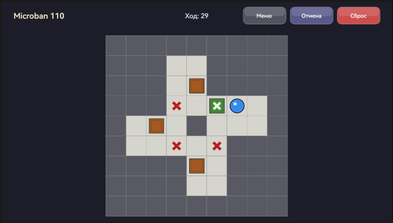
</div>

**3.**
Отказался от идей:
1) создать профиль игрока - совершенно лишнее, головоломка и нет замысла делать какое-то соревнования;
2) музыка или звуковые эффекты - в головоломки типа Сокобан играют фоном, возможно под свою музыку. И любая музыка не подойдет. Решил обойтись без музыки;
3) добавить в игру спрайты — в данном случае не дает особых преимуществ.

**4.**
Ошибки, многочисленные правки:
несмотря на простоту, много запросов ушло на корректную работу переключения уровней, корректное продолжение игры Продолжить, на отображение и расположение кнопок(когда они были), на реализацию алгоритма перемещения ящиков касаниями. Разработка с ИИ это немного лотерея, даже если все корректно написано в запросе.

**5.**
Исходный код игры Сокобан:
[https://github.com/SergeyZ73/Sokoban](https://github.com/SergeyZ73/Sokoban)

**6.**
Игра на RuStore
[https://www.rustore.ru/catalog/app/com.github.SergeyZ73.Sokoban](https://www.rustore.ru/catalog/app/com.github.SergeyZ73.Sokoban)

---

### Повтор генерации игры на основе ТЗ

**1.**
[https://github.com/SergeyZ73/Sokoban/tech_specs/Socoban_TZ_1.md](https://github.com/SergeyZ73/Sokoban/tech_specs/Socoban_TZ_1.md), в ТЗ не сохранена информация об объектах, размерах, цветах. Более стабильная реализация, но вид сильно варьируется. Пример генерации:

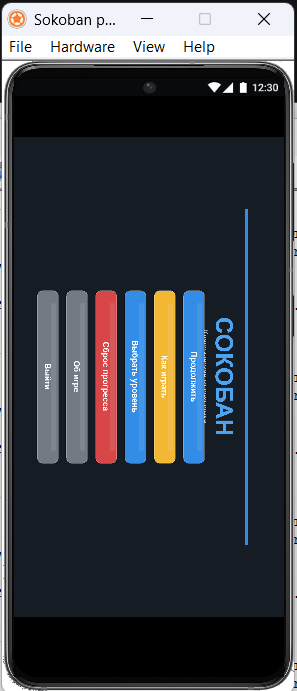
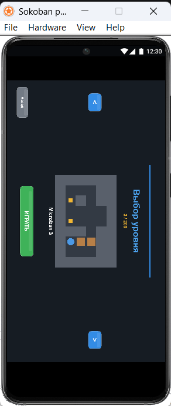
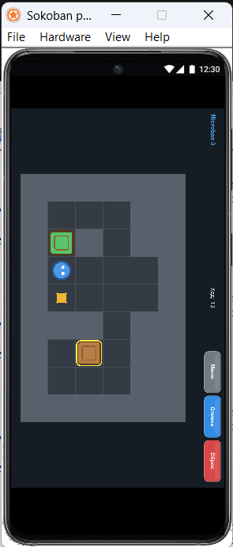

**2.**
[https://github.com/SergeyZ73/Sokoban/tech_specs/Socoban_TZ_2.md](https://github.com/SergeyZ73/Sokoban/tech_specs/Socoban_TZ_2.md), в ТЗ сохранена информация об объектах, размерах, цветах — не факт, что всегда строго будет следовать написанному и может чудить. Пример генерации:

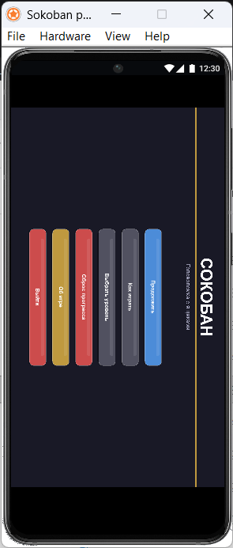
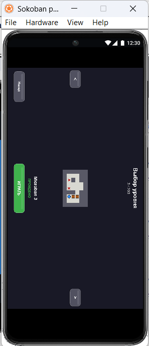
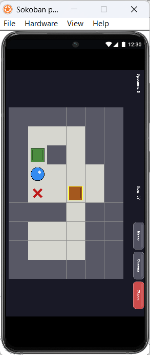

Если возникает черный экран, лучше заново сгенерировать, но можно попробовать дать инструкции из [https://github.com/SergeyZ73/Sokoban/tech_specs/ifBlackScreen_patch_TZ_2.md](https://github.com/SergeyZ73/Sokoban/tech_specs/ifBlackScreen_patch_TZ_2.md)

Причина: В некоторых сборках Solar2D (подтверждено на 3.0.0, Build 2025.3721) менеджер сцен composer перестаёт активировать модульные сцены, документ описывает, как заменить Composer на собственную реализацию modules/sceneManager.lua (~40 строк), совместимую с архитектурой Socoban_TZ_2.md.

**3.**
Разница разработки с помощью ТЗ:
Как стартовая база Socoban_TZ_1.md **устойчивее**, а Socoban_TZ_2.md - **более хрупкое**, оно добавляет много обязательных правил и асинхронности.

**4.**
Если захочется собрать свою версию, используя другие уровни David W. Skinner с сайта [http://users.bentonrea.com/~sasquatch/sokoban/](http://users.bentonrea.com/~sasquatch/sokoban/), то понадобится скрипт Microban.py преобразования уровней в формат data.lua и пример вызова:

`C:\Users\логин\AppData\Local\Programs\Python\Python313\python.exe "C:\Users\логин\AppData\Local\Programs\Python\Python313\Scripts\Microban.py" "C:\Users\логин\AppData\Local\Programs\Python\Python313\Scripts\Microban.txt" "C:\Users\логин\Desktop\data.lua"`

Корректное выполнение: Готово: C:\Users\логин\Desktop\data.lua, уровней: N

**4.1.**
Пример Microban.txt:
```text
; 1

####
# .#
#  ###
#*@  #
#  $ #
#  ###
####
```

**4.2.**
Пример data.lua:
```lua
local data = {
    levels = {
        {
            name = "Microban 1",
            map = {
                "######",
                "# .###",
                "#  ###",
                "#*@  #",
                "#  $ #",
                "#  ###",
                "######",
            }
        },
    }
}

return data
```